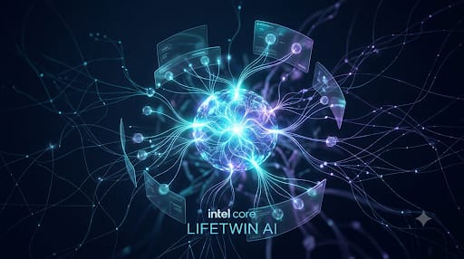
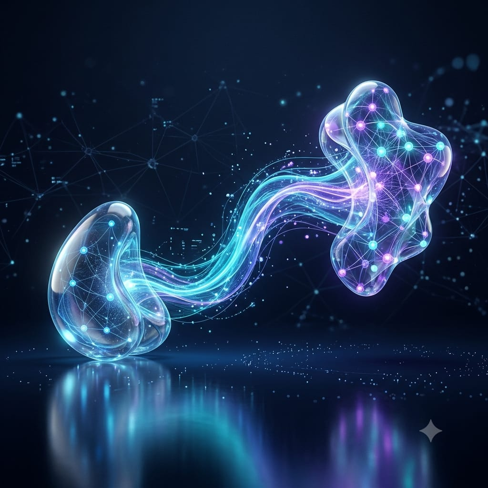
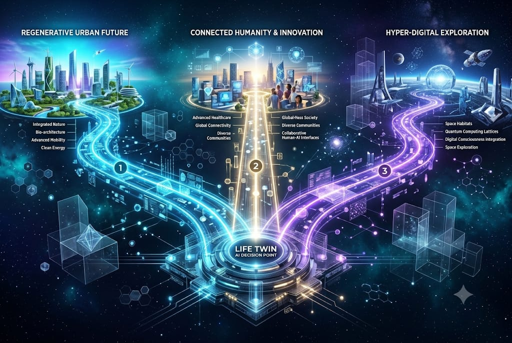

<div align="center">

# ✨ LifeTwin AI


### Your Personal Decision Intelligence Workspace

Explore possibilities. Understand trade-offs. Turn intentions into action.

### Live Dashboard

**Deployment status:** [Open Live Dashboard](https://lifetwin-ai-five.vercel.app)

[Browse Source Code](https://github.com/snehassneha4578-collab/lifetwin-ai) · [Report an Issue](https://github.com/snehassneha4578-collab/lifetwin-ai/issues) · [View Image Gallery](https://github.com/snehassneha4578-collab/lifetwin-ai/tree/master/public/images/lifetwin-ai)

[](https://github.com/snehassneha4578-collab/lifetwin-ai)
[](https://nextjs.org/)
[](https://react.dev/)
[](https://ai.google.dev/)

</div>

---
## 🌌 About LifeTwin AI

<div align="center">
  
</div>

**LifeTwin AI** is an AI-powered decision-support prototype designed to help people explore choices, reflect on personal priorities, consider alternative scenarios, and organize meaningful next steps.

The goal is simple: **use AI to support better thinking while keeping humans in control.**

## ✨ Core Features

<table>
<tr>
<td width="50%" valign="top">

### 🧠 Decision Lab

Structure decisions, evaluate options, and explore relevant considerations.

</td>
<td width="50%" valign="top">

### 🪞 My Life Twin

Reflect on personal context, preferences, and priorities.

</td>
</tr>
<tr>
<td width="50%" valign="top">

### 🔮 Future Scenarios

Explore alternative possibilities, assumptions, and potential trade-offs.

</td>
<td width="50%" valign="top">

### ✅ Action Tracker

Organize intended actions and follow progress toward goals.

</td>
</tr>
<tr>
<td width="50%" valign="top">

### 💬 Decision Companion

Use an AI-assisted conversation to clarify your thinking.

</td>
<td width="50%" valign="top">

### 🛡️ Responsible AI

Review AI-generated suggestions critically and make your own decisions.

</td>
</tr>
</table>

## 🎨 Visual Gallery

Explore the project's visual concepts. Click any image to open the full-size asset.

<table>
<tr>
<td width="50%" align="center">
<a href="public/images/lifetwin-ai/01-hero-background.jpeg"></a>

**🌌 Hero Background**

The main visual introduction to LifeTwin AI and its personal decision-support vision.
</td>
<td width="50%" align="center">
<a href="public/images/lifetwin-ai/02-ai-intelligence-core.jpeg"></a>

**✨ AI Intelligence Core**

Illustrates the AI intelligence concept behind contextual reasoning and personalized insights.
</td>
</tr>
<tr>
<td width="50%" align="center">
<a href="public/images/lifetwin-ai/03-decision-lab.jpeg"></a>

**🧠 Decision Lab**

Explore choices, compare alternatives, and consider potential benefits and trade-offs.
</td>
<td width="50%" align="center">
<a href="public/images/lifetwin-ai/04-my-life-twin.jpeg"></a>

**🪞 My Life Twin**

A personalized companion concept for organizing goals, preferences, and priorities.
</td>
</tr>
<tr>
<td width="50%" align="center">
<a href="public/images/lifetwin-ai/05-future-scenarios.jpeg"></a>

**🔮 Future Scenarios**

Consider alternative paths and possible outcomes before choosing what to do next.
</td>
<td width="50%" align="center">
<a href="public/images/lifetwin-ai/06-action-tracker.jpeg"></a>

**✅ Action Tracker**

Turn intentions into practical next steps and track progress toward personal goals.
</td>
</tr>
<tr>
<td width="50%" align="center">
<a href="public/images/lifetwin-ai/07-personal-growth.jpeg"></a>

**🌱 Personal Growth**

Support reflection, goal-setting, and continuous personal improvement.
</td>
<td width="50%" align="center">
<a href="public/images/lifetwin-ai/08-risk-and-tradeoffs.jpeg"></a>

**⚖️ Risks & Trade-offs**

Examine uncertainty, potential downsides, and competing priorities.
</td>
</tr>
<tr>
<td width="50%" align="center">
<a href="public/images/lifetwin-ai/09-trust-transparency.jpeg"></a>

**🛡️ Trust & Transparency**

Highlights understandable AI assistance, its limitations, and informed user control.
</td>
<td width="50%" align="center">
<a href="public/images/lifetwin-ai/10-ai-architecture.jpeg"></a>

**⚙️ AI Architecture**

Presents the architecture concept for the components supporting the LifeTwin AI experience.
</td>
</tr>
<tr>
<td width="50%" align="center">
<a href="public/images/lifetwin-ai/11-pitch-deck-cover.jpeg"></a>

**🚀 Pitch Deck Cover**

The opening presentation visual introducing the LifeTwin AI concept.
</td>
<td width="50%" align="center">
<a href="public/images/lifetwin-ai/12-pitch-deck-closing.jpeg"></a>

**🎯 Pitch Deck Closing**

The closing presentation visual bringing together the product story and future vision.
</td>
</tr>
</table>

[**📂 Browse all 12 images**](https://github.com/snehassneha4578-collab/lifetwin-ai/tree/master/public/images/lifetwin-ai)

## ⚙️ Technology Stack

<div align="center">

[](https://nextjs.org/docs/app)
[](https://react.dev/)
[](https://www.typescriptlang.org/)
[](https://ai.google.dev/)
[](https://recharts.org/)
[](https://lucide.dev/)

</div>

| Technology | Purpose |
|---|---|
| Next.js | Application framework |
| React | User interface |
| TypeScript | Typed JavaScript |
| Google Gemini | AI integration |
| Recharts | Data visualizations |
| Lucide React | Icons |
| Zod | Schema validation |

## 🚀 Run Locally

### 1. Clone the repository

```powershell
git clone https://github.com/snehassneha4578-collab/lifetwin-ai.git
cd lifetwin-ai
npm ci
```

### 2. Configure your environment

Create `.env.local` in the project root:

```dotenv
GEMINI_API_KEY=your_gemini_api_key
```

Replace the placeholder with your own Gemini API key. **Never commit your actual API key.** Keep `.env.local` private.

### 3. Start the development server

```powershell
npm run dev
```

Open [http://localhost:3000](http://localhost:3000).

### Useful commands

| Command | Purpose |
|---|---|
| `npm run dev` | Start the development server |
| `npm run build` | Build for production |
| `npm run start` | Start the production server |
| `npm run lint` | Run ESLint, if configured |

## 🛡️ Responsible AI

- AI-generated responses can be incomplete or incorrect.
- Scenarios are possibilities, not guaranteed predictions.
- Review important information and verify critical claims.
- Keep control of your choices and decisions.
- This prototype is not a substitute for qualified professional advice.

## 🗺️ Roadmap

- [x] Publish the source repository on GitHub.
- [x] Create a visual README gallery for 12 project images.
- [ ] Deploy the dashboard to a public hosting provider.
- [x] Add the verified live dashboard URL.
- [ ] Test the complete Gemini chat workflow.
- [ ] Expand automated tests and document known limitations.

## 🤝 Contributing

Have an idea or found a bug? Contributions and constructive feedback are welcome.

[**âž• Open an issue on GitHub**](https://github.com/snehassneha4578-collab/lifetwin-ai/issues)

## 📄 License

No license has been selected yet. All rights are reserved by default until a license is added.

---

<div align="center">

### 💜 Think clearly. Explore thoughtfully. Act intentionally.

[**⭐ Explore LifeTwin AI on GitHub**](https://github.com/snehassneha4578-collab/lifetwin-ai)

</div>
